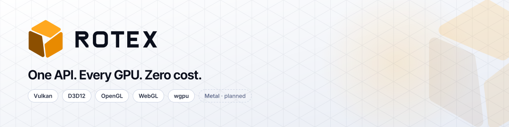
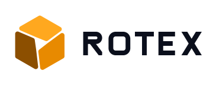

<p align="center">
  <picture>
    <source media="(prefers-color-scheme: dark)" srcset="brand/github/rotex-readme-banner-dark.svg">
    <source media="(prefers-color-scheme: light)" srcset="brand/github/rotex-readme-banner-light.svg">
    
  </picture>
</p>

# rotex-assets

Official brand and visual assets for [Rotex Engine](https://github.com/rotex-labs), a modular Rust graphics engine with one rendering API over Vulkan, Direct3D 12, OpenGL / WebGL and wgpu. This repository holds the **Rotor Cube** identity (brand v1.0): logos, icons, GitHub and social images, docs styling and backend badges.

## Folder index

| Folder | Contents |
|---|---|
| [`brand/logo/`](brand/logo) | Mark, horizontal, stacked and wordmark lockups in color-on-dark, color-on-light, mono-black and mono-white (SVG + PNG). See [`brand/logo/README.md`](brand/logo/README.md) for clear space and minimum size. |
| [`brand/icons/`](brand/icons) | `favicon.svg`, 16/32/48 PNG favicons, `favicon.ico`, Apple touch icon, app icons, maskable icon |
| [`brand/github/`](brand/github) | Org avatar, repo social preview (1280×640), README banners (dark/light), org profile README draft |
| [`brand/social/`](brand/social) | X, LinkedIn, Bluesky, Discord and Open Graph images, plus an editable release-announcement template |
| [`brand/docs/`](brand/docs) | Docs hero, `rotex-tokens.css`, Mermaid themes (`mermaid-theme-{dark,light}.json`), code and diagram style, per-crate README headers |
| [`brand/badges/`](brand/badges) | Backend badges (Vulkan, D3D12, OpenGL, WebGL, wgpu, Metal; with or without status) and capability badges (Native / Emulated / Absent) |
| [`brand/guidelines/`](brand/guidelines) | [Brand guidelines](brand/guidelines/brand-guidelines.md) ([PDF](brand/guidelines/brand-guidelines.pdf)) and construction / do-and-don't images |
| [`legacy/`](legacy) | The pre-v1 rotor logos, kept for history |

Fonts (Inter, Inter Tight, JetBrains Mono, all OFL-1.1) are not stored here; get them from their upstream projects. The full kit, including slides and print files, is attached to the `brand-v1.0` GitHub Release.

## Using the logo

Use the `<picture>` element so the logo follows the reader's light or dark theme. Pin to the `brand-v1.0` tag so the image does not change under you:

```html
<picture>
  <source media="(prefers-color-scheme: dark)"  srcset="https://raw.githubusercontent.com/rotex-labs/rotex-assets/brand-v1.0/brand/logo/horizontal/rotex-lockup-horizontal-color-on-dark.svg">
  <source media="(prefers-color-scheme: light)" srcset="https://raw.githubusercontent.com/rotex-labs/rotex-assets/brand-v1.0/brand/logo/horizontal/rotex-lockup-horizontal-color-on-light.svg">
  
</picture>
```

Do not recolor, stretch, rotate or rebuild the mark. Read the [brand guidelines](brand/guidelines/brand-guidelines.md) before using it elsewhere.

## License

- **Code and tooling** (CSS tokens, Mermaid themes, CI and scripts): MIT, see [LICENSE](LICENSE).
- **Brand marks** (the Rotex name, Rotor Cube mark, logos, wordmark and the images built from them): **not** MIT. See [BRAND-LICENSE.md](BRAND-LICENSE.md).
