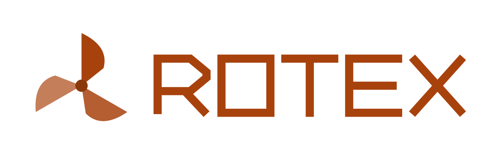
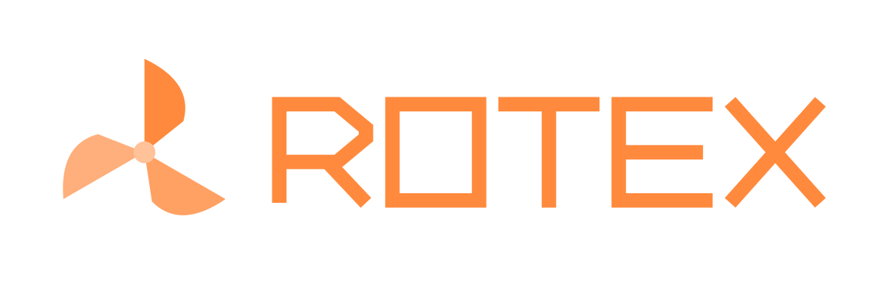

# Brand assets

Logos and marks for [rotexengine](https://github.com/rotexengine) projects.

## Color values

| Token | Light theme | Dark theme | Usage |
|-------|-------------|------------|-------|
| Primary | `#A8420D` | `#FF8A3D` | Blades, wordmark |
| Accent | `#8A3A0A` | `#FFC299` | Mark center dot |

## Files

| File | Description |
|------|-------------|
| `logo/rotex-mark-light.svg` | Mark only — light backgrounds |
| `logo/rotex-mark-dark.svg` | Mark only — dark backgrounds |
| `logo/rotex-logo-light.svg` | Full logo (mark + geometric wordmark) — light backgrounds |
| `logo/rotex-logo-dark.svg` | Full logo (mark + geometric wordmark) — dark backgrounds |

## Master sizes

- **Full logo:** `1200 × 400` (3:1 marketing lockup)
- **Mark:** `512 × 512` (1:1 app, profile, and social asset)

Both formats are SVG and can be resized without quality loss. Preserve their aspect ratios and do not stretch them.

## Wordmark

The full logo spells **ROTEX** using custom uppercase geometric letterforms built from SVG paths — no font text. Every glyph shares the same cap line, baseline, height, and monoline weight, with sharp rectangular construction and consistent tracking.

Pick the variant that matches your background:

- **Light** — rust-orange on white or light surfaces
- **Dark** — brightened orange on dark surfaces

## Usage

```html
<!-- Light background -->


<!-- Dark background -->

```

Use the mark-only files when space is tight (favicons, app icons, avatars). Use the full logo for headers, README banners, and documentation heroes.
