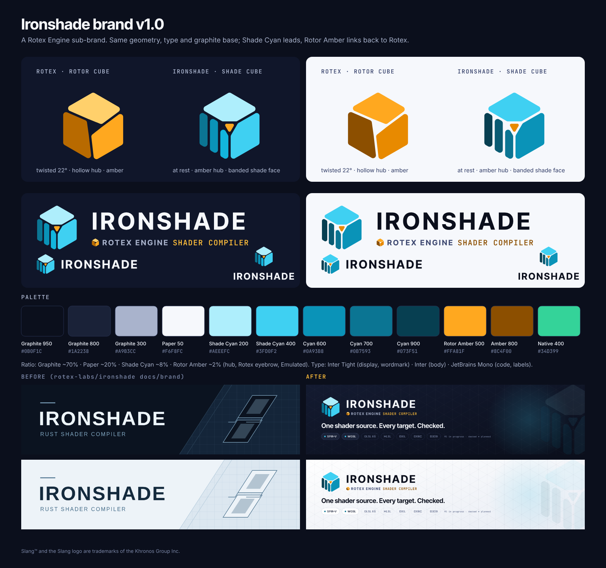
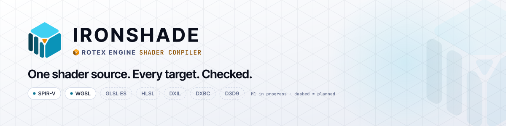

# Ironshade

Sub-brand assets for [Ironshade](https://github.com/rotex-labs/ironshade), the pure-Rust shader compiler in the Rotex family. The identity is the **Shade Cube**, built on the Rotex brand v1.0 Rotor Cube system: same construction at rest, Shade Cyan in the lead, Rotor Amber kept for the hub and the endorsement.

Read the [Ironshade brand guidelines](guidelines/brand-guidelines.md) before using the marks. The Rotex rules still apply: [brand guidelines](../guidelines/brand-guidelines.md), [usage terms](../../BRAND-LICENSE.md).

## Folder index

| Folder | Contents |
|---|---|
| [`logo/`](logo) | Mark, endorsed, horizontal, stacked and wordmark lockups in four colourways (SVG + PNG). See [`logo/README.md`](logo/README.md). |
| [`icons/`](icons) | Scheme-aware `favicon.svg`, 16/32 px small cuts for dark and light, 512 px avatar |
| [`github/`](github) | README banners (dark/light) and social previews (dark/light) |
| [`tokens/`](tokens) | `ironshade-tokens.css`, Tailwind v3 (`tailwind.config.js`) and v4 (`tailwind-v4.css`), `palette.json` |
| [`guidelines/`](guidelines/brand-guidelines.md) | Ironshade brand guidelines |
| [`readme/README-header.md`](readme/README-header.md) | README header draft in the Rotex layout |
| [`cli/CLI-COLORS.md`](cli/CLI-COLORS.md) | `ironshadec` terminal colour and symbol rules |

## README banners

Use the `<picture>` element so the banner follows the reader's theme. Replace `<REF>` with a tag or commit before pinning the URL from another repository. Inside this repository the paths are:

  <picture>
    <source media="(prefers-color-scheme: dark)" srcset="github/ironshade-readme-banner-dark.svg">
    <source media="(prefers-color-scheme: light)" srcset="github/ironshade-readme-banner-light.svg">
    
  </picture>

| Asset | Path |
|---|---|
| README banner, dark | [`github/ironshade-readme-banner-dark.svg`](github/ironshade-readme-banner-dark.svg) · [`1200×300 PNG`](github/ironshade-readme-banner-dark-1200x300.png) · [`2400×600 PNG`](github/ironshade-readme-banner-dark-2400x600.png) |
| README banner, light | [`github/ironshade-readme-banner-light.svg`](github/ironshade-readme-banner-light.svg) · [`1200×300 PNG`](github/ironshade-readme-banner-light-1200x300.png) · [`2400×600 PNG`](github/ironshade-readme-banner-light-2400x600.png) |
| Social preview, dark | [`github/ironshade-social-preview-dark.svg`](github/ironshade-social-preview-dark.svg) · [`1280×640 PNG`](github/ironshade-social-preview-dark-1280x640.png) |
| Social preview, light | [`github/ironshade-social-preview-light.svg`](github/ironshade-social-preview-light.svg) · [`1280×640 PNG`](github/ironshade-social-preview-light-1280x640.png) |
| Mark, colour on dark | [`logo/mark/ironshade-mark-color-on-dark.svg`](logo/mark/ironshade-mark-color-on-dark.svg) |
| Mark, colour on light | [`logo/mark/ironshade-mark-color-on-light.svg`](logo/mark/ironshade-mark-color-on-light.svg) |
| Mark, mono black | [`logo/mark/ironshade-mark-mono-black.svg`](logo/mark/ironshade-mark-mono-black.svg) |
| Mark, mono white | [`logo/mark/ironshade-mark-mono-white.svg`](logo/mark/ironshade-mark-mono-white.svg) |

The GitHub repository social preview setting takes the dark 1280×640 PNG. The SVG is the master.

## License

- **Tokens and other code** in this folder: MIT, see the repository [LICENSE](../../LICENSE).
- **Marks** (the Ironshade name, Shade Cube, wordmark, endorsed lockup and the images built from them): not MIT. See [BRAND-LICENSE.md](../../BRAND-LICENSE.md).
