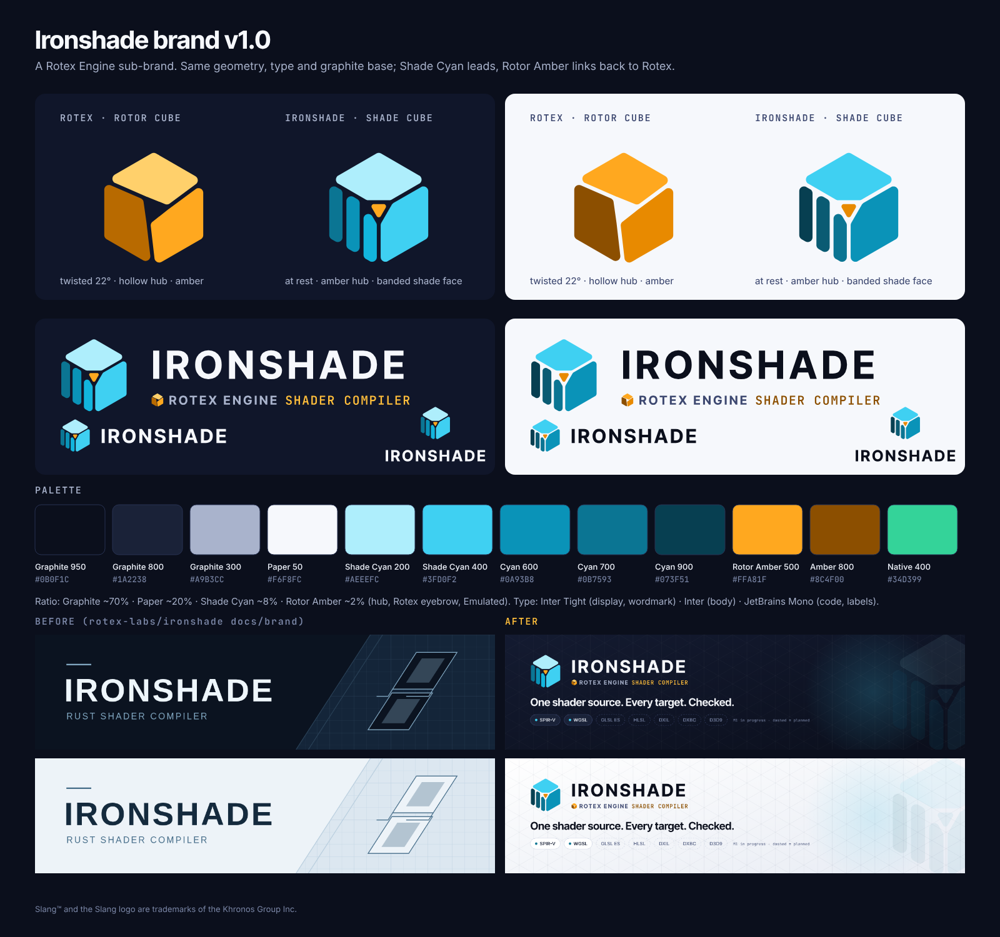

# Ironshade brand guidelines, v1.0

Ironshade is a sub-brand of [Rotex Engine](https://github.com/rotex-labs). It has its own name and mark, and it is visibly endorsed by Rotex. These rules sit on the [Rotex brand guidelines, v1.0](../../guidelines/brand-guidelines.md) (the Rotor Cube system). Where this file is silent, the Rotex rules apply.



## 1. Story and positioning

**Ironshade** is the pure-Rust shader compiler in the Rotex family (`rotex-labs/ironshade`, crates `ironshade-*`, CLI `ironshadec`). It prepares shader source for the backends Rotex runs.

**Positioning line:** *One shader source. Every target. Checked.*

**Descriptor:** *A pure-Rust shader compiler for Rotex Engine, with a pluggable backend HAL.*

**Who it is for:** engine and tools programmers who want one shader source lowered, checked and emitted for more than one target.

**Proof points:** a shared graph IR, a public backend HAL, legalization diagnostics, and differential testing against a reference compiler. "Checked" means those two, not a claim of conformance.

Ironshade leads with Shade Cyan. Rotex leads with Rotor Amber. The two stay easy to tell apart side by side, and the amber hub plus the endorsed lockup keep Ironshade in the family.

## 2. Name usage

| Use | Avoid |
|---|---|
| **Ironshade** in running text | IRONSHADE in body text (all caps belongs to the wordmark only), IronShade, Iron Shade |
| `ironshade`, `ironshade-ir`, `ironshadec`: crate and CLI names in lowercase code style | "Ironshade-IR", "IronshadeC" |
| "a shader compiler for Rotex Engine" | A name that hides the Rotex endorsement, or a name that presents Ironshade as Rotex itself |
| Nominative mention of the shading language, as in "aims to compile the Slang™ shading language" | "official", "conformant", or "Slang compiler" as a product name; the Slang logo |

Write target and API names exactly, as the Rotex guidelines do: **SPIR-V**, **WGSL**, **GLSL ES**, **HLSL**, **DXIL**, **DXBC**, **Vulkan**, **WebGPU**, **wgpu**, **Direct3D 12**. These are trademarks of their owners. Use them as plain text and never use their logos in Ironshade marketing art.

Mention Slang only nominatively. Never use the Slang logo. Wherever Slang is mentioned, include:

> Slang™ and the Slang logo are trademarks of the Khronos Group Inc.

The brand art does not mention Slang, so the logo, banner and social files need no notice. The README footer does, because the README names the language. See [`../readme/README-header.md`](../readme/README-header.md).

## 3. Logo

**The mark: Shade Cube.** The Rotor Cube's construction at rest. Same hexagon of radius R, same hub circumradius 0.24R, same gaps 0.065R and corner radius 0.08R, with **no twist**.

- **Untwisted cube:** the rotor has stopped. This is the build-time tool that prepares what the engine spins.
- **Banded shade face:** the dark face is cut into three bands, a shading ramp. It also reads as one source split into several targets, and as passes in a pipeline.
- **Amber hub:** where Rotex leaves the hub hollow, Ironshade fills it with Rotor Amber. It is the graph IR every shader passes through, and the amber touch that ties the mark to Rotex.

| Background | Lit (top) | Mid (right) | Bands, outer to inner | Hub |
|---|---|---|---|---|
| Dark | Cyan 200 `#AEEEFC` | Cyan 400 `#3FD0F2` | Cyan 700 `#0B7593`, 600 `#0A93B8`, 500 `#12B5DD` | Amber 500 `#FFA81F` |
| Light | Cyan 400 `#3FD0F2` | Cyan 600 `#0A93B8` | Cyan 900 `#073F51`, 800 `#0A5B73`, 700 `#0B7593` | Amber 600 `#E88A00` |

At 32 px and below use the small cut in [`../icons/`](../icons/): two bands, wider gaps (0.10R) and a larger hub.

**Lockups** ([`../logo/`](../logo/)):

| Lockup | Construction (M = mark height) | Use |
|---|---|---|
| endorsed (primary) | wordmark cap height 0.36M, gap 0.30M; endorsement line: mini Rotor Cube + `ROTEX ENGINE` (Inter Tight 700, tracking +16%) + `SHADER COMPILER` (JetBrains Mono 600, amber) | README banners, social, docs home |
| horizontal | wordmark cap height 0.40M, gap 0.30M, same proportions as the Rotex horizontal lockup | Navbars, small spaces |
| stacked | wordmark cap height 0.32M, gap 0.26M, same proportions as Rotex | Square spaces, merch |
| wordmark only | the wordmark on its own | When the mark is already nearby |
| mark only | the mark on its own | Avatars, favicons, inline |

Each lockup comes in four colour versions: `color-on-dark`, `color-on-light`, `mono-black` and `mono-white`. The SVG files are the masters. The PNGs are exports.

The endorsement line is the **only** place the Rotor Cube appears inside Ironshade art. It sits beside the text and is never merged into the Shade Cube. That stays inside the Rotex rule against combining the mark with other logos into a new mark. Use the shipped endorsed lockup; do not build another combination.

**Clear space.** Keep at least **x** free on every side, where x = the wordmark cap height. For the mark alone, x = 0.25 × mark height. The lockup SVGs already include this padding. The mark SVGs include only a 10% safe margin, so add the rest in layout. See the Rotex clear-space diagram in [`../../guidelines/img/clear-space.svg`](../../guidelines/img/clear-space.svg).

**Minimum sizes**

| Asset | Minimum size |
|---|---|
| Mark | 16 px / 4 mm (use the small cut at 32 px and below) |
| Endorsed lockup | Keep the wordmark at least 64 px wide (same floor as the wordmark alone) |
| Horizontal lockup | 96 px / 20 mm wide |
| Stacked lockup | 64 px / 15 mm wide |
| Wordmark | 64 px wide |

**The wordmark** is `IRONSHADE` in Inter Tight 720, tracking +11%, outlined so no font is needed. It matches the weight and width of the Rotex caps. It is not the Rotex wordmark retyped. Never retype either wordmark in a font.

**Do**
- Use the colour versions on Graphite or Paper.
- Use the mono versions on photographs, merch or single-colour print.
- Keep the mark upright.
- Use the endorsed lockup when the Rotex relationship should be visible.

**Don't**
- Stretch the logo, rotate the lockup or rearrange its parts.
- Recolour it, especially in rust, red or the old steel blues.
- Add shadows, glows or outlines.
- Put it on mid-cyan or busy backgrounds.
- Retype the wordmark.
- Merge the Rotor Cube into the Shade Cube, or draw a new lockup that pairs the two marks.

File-level clear space, colourways and export sizes are in [`../logo/README.md`](../logo/README.md).

## 4. Colour

Ironshade shares the Rotex palette and swaps which accent leads. In the Rotex guidelines, cyan already means data and shader flow, so a shader compiler leading with cyan is the sibling of an engine leading with amber.

| Token | Hex | Role in Ironshade |
|---|---|---|
| Graphite 950 / 900 / 800 / 700 | `#0B0F1C` `#10162A` `#1A2238` `#283252` | Backgrounds, surfaces, borders (shared) |
| Graphite 300 / 400 / 600 | `#A9B3CC` `#7C88A8` `#3D4870` | Muted and subtle text (shared) |
| Paper 50 | `#F6F8FC` | Light background, text on dark (shared) |
| **Shade Cyan 400** | **`#3FD0F2`** | Primary accent on dark, buttons (Graphite text on top, 10.5:1) |
| Cyan 200 / 300 | `#AEEEFC` `#7FE3FA` | Mark lit face, links on dark |
| Cyan 500 / 600 | `#12B5DD` `#0A93B8` | Mark faces, glow |
| Cyan 700 / 800 / 900 | `#0B7593` `#0A5B73` `#073F51` | Accent and links on light (700 is 5.3:1 on white), mark bands on light |
| Rotor Amber 500 / 400 / 800 | `#FFA81F` `#FFBE3B` `#8C4F00` | Hub, Rotex endorsement, warnings, Emulated |
| Native 400 / 700 | `#34D399` `#0E7A55` | Native, success |

**Ratio.** Graphite about 70%, Paper about 20%, Shade Cyan about 8%, Rotor Amber about 2%. Amber is never a page or button colour in Ironshade.

**Never** use rust or red-orange, and never bring back the old steel blues (`#0B1320`, `#142539`, `#81A7C1` and their neighbours).

**WCAG contrast, measured**

```
Shade Cyan 400 on Graphite 950                #3FD0F2 / #0B0F1C  10.48:1  AAA
Cyan 300 on Graphite 950                      #7FE3FA / #0B0F1C  12.98:1  AAA
Graphite 950 on Shade Cyan 400 (buttons)      #0B0F1C / #3FD0F2  10.48:1  AAA
Cyan 700 on White                             #0B7593 / #FFFFFF   5.28:1  AA
Cyan 700 on Paper 50                          #0B7593 / #F6F8FC   4.96:1  AA
Cyan 800 on White                             #0A5B73 / #FFFFFF   7.62:1  AAA
Amber 800 on Paper 50                         #8C4F00 / #F6F8FC   6.11:1  AA
Cyan 400 on Paper 50 (graphics only)          #3FD0F2 / #F6F8FC   1.72:1  Fail (decor only)
```

**Rules**
- Never set Shade Cyan 400 *text* on Paper or white. Use Cyan 700 (or 800 for small text).
- Shade Cyan on a light ground fails as text. Use it for graphics and for button fills, with Graphite or white text on top.
- Amber text on a light ground uses Amber 800, the same rule as Rotex.

Tokens for CSS, Tailwind v3, Tailwind v4 and a palette JSON file are in [`../tokens/`](../tokens/). They repeat the shared Rotex values so the file works on its own, and they change only the semantic accent.

## 5. Typography

Same faces as Rotex. All three are SIL Open Font License 1.1. They are not stored in this repository; get them from their upstream projects.

| Role | Face | Weights | Notes |
|---|---|---|---|
| Display, headlines, wordmark | **Inter Tight** | 650–750 (wordmark 720) | display tracking −1 to −2%; wordmark +11% |
| UI and body | **Inter** | 400 / 500 / 600 | 16 px base, 1.6 line height |
| Code, crate names, CLI samples, labels | **JetBrains Mono** | 400 / 500 / 600 / 700 | uppercase labels tracked +12% |

**Crate and type names** are always in mono: `ironshade-target`, `Target`, `CapabilityTable`.

Text in the art SVGs is outlined, so the files render on GitHub without the fonts installed.

## 6. Imagery and pattern language

The Rotex rules hold: isometric lattice at 3–7% opacity, one oversized ghost mark at about 6–8% opacity anchored to one edge, and **one** soft glow per layout. Ironshade's glow is Shade Cyan, and the ghost mark is the Shade Cube.

**Status chips.** A solid chip with a cyan dot means in progress or active. A dashed chip means planned. Update them when the code changes. At the v1.0 identity, SPIR-V and WGSL (M1) are in progress; later targets are planned.

**Avoid** stock photos of GPUs, lens flares, neon cyberpunk looks, vendor logos and the Slang logo. Slang™ and the Slang logo are trademarks of the Khronos Group Inc.

## 7. Components

| Component | Location and details |
|---|---|
| README banners | [`../github/ironshade-readme-banner-dark.svg`](../github/ironshade-readme-banner-dark.svg) and [`../github/ironshade-readme-banner-light.svg`](../github/ironshade-readme-banner-light.svg), 1200×300, plus 2400×600 PNGs. Use a `<picture>` element. The header draft is [`../readme/README-header.md`](../readme/README-header.md). |
| Social previews | [`../github/ironshade-social-preview-dark.svg`](../github/ironshade-social-preview-dark.svg) and [`../github/ironshade-social-preview-light.svg`](../github/ironshade-social-preview-light.svg), with 1280×640 PNGs. The GitHub social preview setting uses the dark PNG. |
| Icons | [`../icons/favicon.svg`](../icons/favicon.svg) follows the reader's colour scheme. Theme-specific small cuts are `ironshade-favicon-{dark,light}-{16,32}.png`. The avatar is `ironshade-avatar.svg` and `ironshade-avatar-512.png`. |
| CLI colour | [`../cli/CLI-COLORS.md`](../cli/CLI-COLORS.md). Colour is a second channel. Every line also carries a word or a symbol. Honor `NO_COLOR`. |
| Tokens | [`../tokens/ironshade-tokens.css`](../tokens/ironshade-tokens.css), [`../tokens/tailwind.config.js`](../tokens/tailwind.config.js), [`../tokens/tailwind-v4.css`](../tokens/tailwind-v4.css), [`../tokens/palette.json`](../tokens/palette.json). |

Capability words extend the Rotex set: **Native**, **Lowered**, **Emulated** (needs an explicit policy), **Unsupported**, **Unknown**. Native is green, Lowered is cyan, Emulated is amber, Unsupported is the error red, Unknown is graphite. Do not use colour alone; pair it with the symbol from the CLI rules.

## 8. Voice and tone

Ironshade uses the Rotex voice: **precise, honest and calm**.

- **Show the capability table before claims.** Say what is in progress, what is planned, and what a target does not do yet.
- **Show code and diagnostics before adjectives.**
- **Use short sentences and active verbs.** Avoid hype words such as "revolutionary", "blazing" and "next-gen".
- **"Checked"** means legalization diagnostics and differential testing. It does not mean conformance, and it does not mean official.

| Instead of | Write |
|---|---|
| "The official Slang compiler for every GPU!!" | "A pure-Rust shader compiler for Rotex Engine. It aims to compile the Slang™ shading language." |
| "WGSL support" | "WGSL: M1, in progress. GLSL ES 3.00: planned." |

Slang™ and the Slang logo are trademarks of the Khronos Group Inc.

## 9. Taglines

1. **One shader source. Every target. Checked.** (recommended): it mirrors "One API. Every GPU. Zero cost." and names the three claims in order.
2. *A pure-Rust shader compiler for Rotex Engine.*: the descriptor, for crates.io and the GitHub description.
3. *One source, checked on the way out.*: shorter, for talks.

## 10. Asset index

| Path | Contents |
|---|---|
| [`../logo/`](../logo/) | Mark, horizontal, endorsed, stacked and wordmark lockups, four colourways, SVG + PNG |
| [`../icons/`](../icons/) | Favicon (scheme-aware and per-theme small cuts) and 512 px avatar |
| [`../github/`](../github/) | README banners (dark/light, SVG, 1200×300 and 2400×600 PNG) and social previews (dark/light, SVG and 1280×640 PNG) |
| [`../tokens/`](../tokens/) | CSS tokens, Tailwind v3 config, Tailwind v4 theme, `palette.json` |
| [`../readme/README-header.md`](../readme/README-header.md) | README header in the Rotex layout |
| [`../cli/CLI-COLORS.md`](../cli/CLI-COLORS.md) | `ironshadec` colour, symbol and layout rules |
| [`../preview.png`](../preview.png) | One-sheet of the mark, lockups and palette ([SVG master](../preview.svg)) |

The repository index is the root [`README.md`](../../../README.md). Usage terms for the marks are in [`BRAND-LICENSE.md`](../../../BRAND-LICENSE.md).
